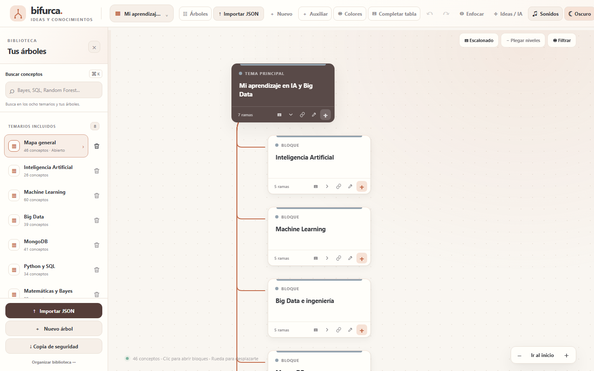
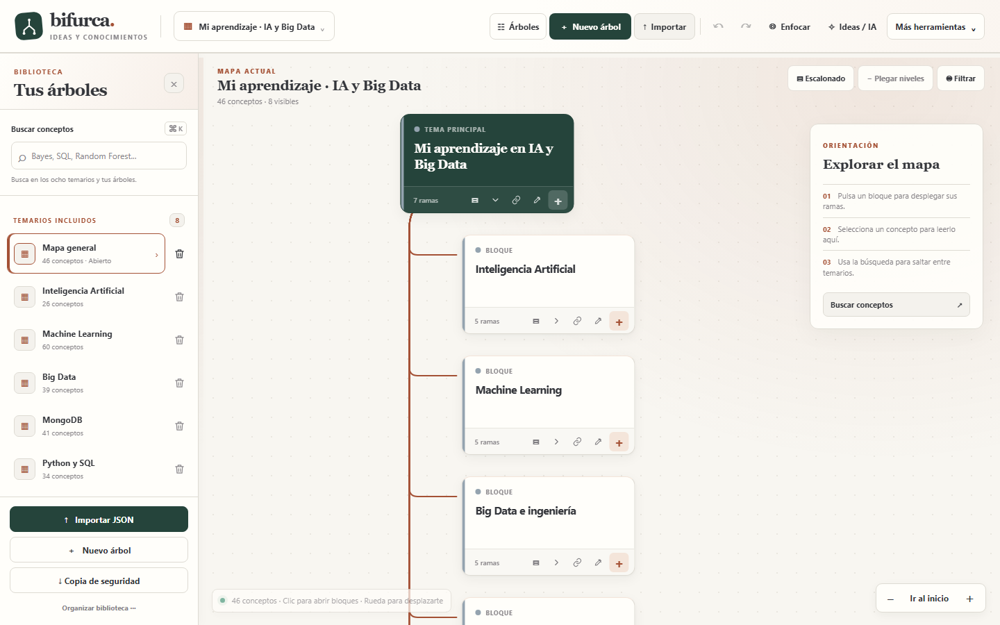
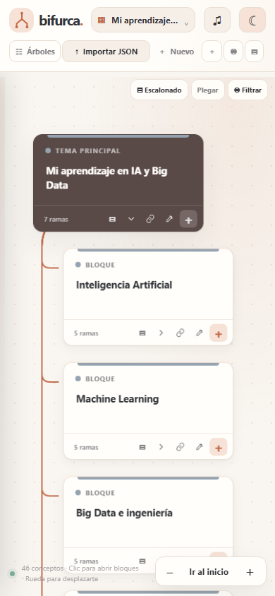
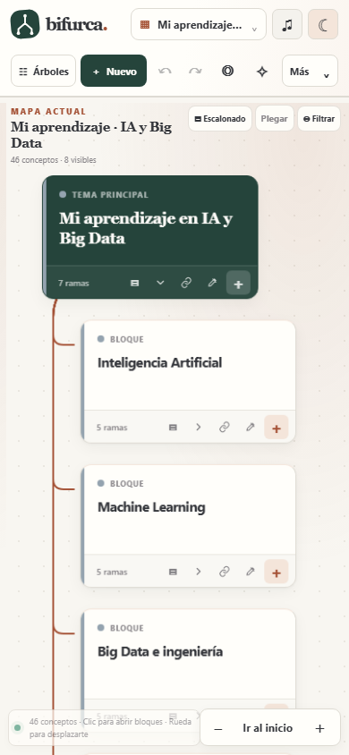

# BIFURCA · Rediseño UX/UI

## Auditoría de la versión publicada

Explorada con Playwright a 1440 × 900 y 390 × 844 en un contexto nuevo de Chromium. La versión pública y `main` mostraban la misma interfaz v1.3.0 y ocho tarjetas visibles al abrir el mapa general. No hubo errores JavaScript durante la exploración.

- La barra superior distribuía más de una docena de acciones con peso visual parecido. En móvil dependía del desplazamiento horizontal para descubrir controles.
- El lienzo tenía mucho espacio a la derecha sin una ayuda inicial ni una lectura contextual del concepto seleccionado.
- La tarjeta ofrecía iconos útiles, pero su significado dependía de `title` y la explicación requería expandir dentro de la tarjeta o entrar al editor.
- La jerarquía entre mapa, bloque y concepto era funcional, aunque el entorno visual no ayudaba suficientemente a orientarse en mapas grandes.
- La biblioteca, el buscador, las copias, el filtro y los temas ya funcionaban y convenía conservarlos.

## Dirección de diseño

Un **estudio cartográfico de conocimiento**: superficie clara, conexiones legibles, verde profundo para el origen, acento de arcilla para estados y acciones, y tipografía editorial limitada a títulos de orientación. Las fichas de conceptos mantienen una sans serif legible durante sesiones largas. Los otros tres temas y el modo oscuro permanecen disponibles.

## Cambios

1. **Acciones por frecuencia.** Crear, importar, deshacer, rehacer, enfocar e Ideas / IA permanecen a la vista. Configuración, glosario, nodo auxiliar, completar y exportar están en «Más herramientas». La biblioteca conserva sus accesos directos a importación y copia completa.
2. **Orientación permanente.** El lienzo identifica el mapa y muestra conceptos totales y visibles; una ayuda breve explica las tres primeras tareas sin interceptar el árbol. Se oculta en anchos reducidos y al abrir el detalle.
3. **Lectura contextual.** Seleccionar un nodo muestra su ruta, estado del glosario, subramas, explicación, ejemplo y notas. «Centrar», «Editar» y «Subrama» usan los flujos existentes. Cerrar el panel o pulsar Escape devuelve la vista general.
4. **Árbol más claro.** Mayor diferencia visual del nodo raíz, conectores y tarjetas más sobrios, selección visible y controles con foco. No cambia el algoritmo de disposición ni el crecimiento vertical.
5. **Móvil.** Acciones esenciales en una fila sin desplazamiento horizontal. La lectura contextual utiliza una hoja inferior que no borra el mapa y se puede cerrar.
6. **Teclado.** Flechas ↑/↓ recorren nodos visibles; Inicio/Fin saltan a los extremos; → abre una rama o entra en su primer descendiente; ← pliega o vuelve al padre; F2 edita. Enter y Espacio conservan la interacción principal.

## Datos y compatibilidad

No se cambiaron `KEY='bifurca_v3_app'`, `MIGRATION_BACKUP_KEY='bifurca_v3_before_visual_v1'`, `SOUND_KEY='bifurca_audio_v1'`, el esquema exportado `bifurca-v4` ni las funciones de importación, migración y copia de seguridad. El panel de lectura deriva su contenido del árbol abierto y no escribe un formato nuevo. La guía y el menú son estados de interfaz.

El test crea sus árboles en un perfil Playwright temporal; no utiliza ni borra el perfil personal. **No se ha desplegado**. Antes del despliegue, exportar una copia JSON completa desde la web pública en el navegador habitual y probar esa copia en un contexto aislado. Después se podrá comprobar la nueva versión contra los datos reales sin sustituirlos.

## Verificación

Ejecutar un servidor estático en la raíz y `python tests/qa_redesign.py` con Playwright para Python instalado. La batería comprueba:

- Mapa inicial, despliegue y plegado, orientación, panel y botones contextuales.
- Navegación por teclado y editor con F2.
- Búsqueda entre temarios, mapa de 60 conceptos, distribución escalonada/horizontal y filtro por glosario.
- Creación, edición, deshacer/rehacer, conexión transversal, exportación JSON y copia completa.
- Importación del JSON generado y persistencia tras recargar con la misma clave local.
- Acceso a Ideas / IA, glosario, sonidos y cambio de tema.
- Móvil sin desbordamiento horizontal, navegación lateral y panel táctil.
- `prefers-reduced-motion` y ausencia de excepciones JavaScript.

### Capturas

| Antes, versión publicada | Después, rama de rediseño |
| --- | --- |
|  |  |
|  |  |

[Detalle de concepto](capturas/detalle-concepto.png) · [Detalle móvil](capturas/detalle-movil.png)

## Límites

- La compatibilidad se ha comprobado con árboles incluidos y datos aislados. Falta la verificación con una exportación real del navegador personal antes de publicar.
- Las animaciones de sonido se prueban como estado y control, no con una evaluación auditiva.
- La prueba móvil se ejecuta en viewport táctil simulado; queda la comprobación manual en un dispositivo físico.
