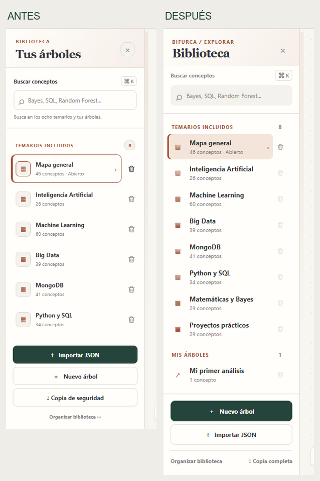
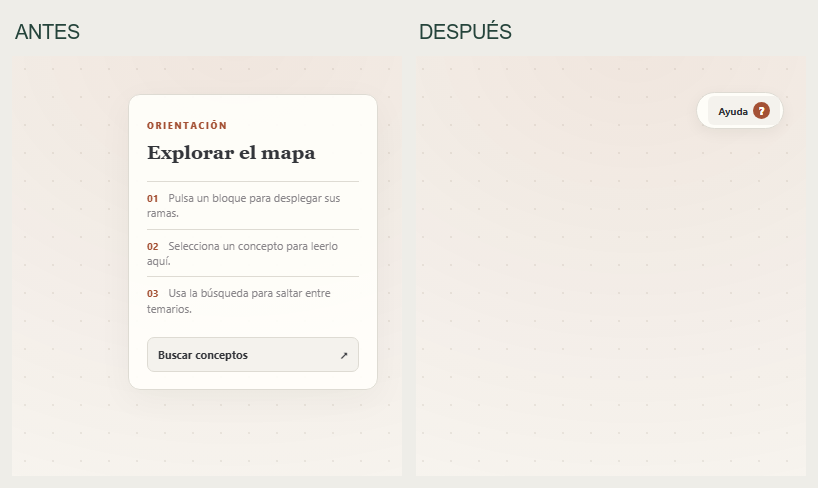
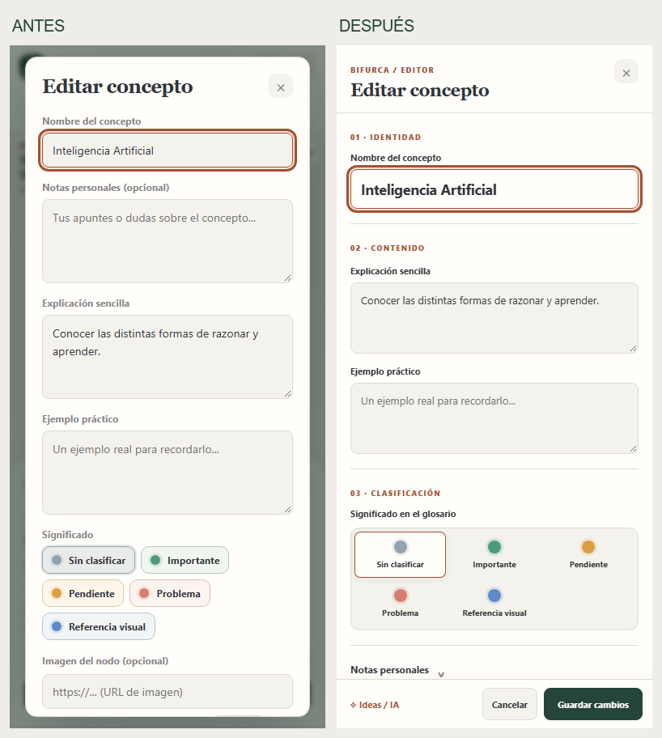

# BIFURCA · Refinamiento de biblioteca, orientación y editor

## Antes de cambiar

Se tomaron capturas del commit `c021d7c` a 1440 × 900 y 390 × 844 en perfiles Playwright nuevos. La biblioteca usaba 286 px y repetía contornos alrededor de cada árbol y acción; en la primera pantalla no mostraba todos los temarios. La guía permanecía expandida. El editor móvil mostraba primero tres campos largos y dejaba «Guardar cambios» fuera de la vista inicial. La lógica de datos y las protecciones destructivas funcionaban y se conservaron.

## Decisiones

### Biblioteca

- Ancho de 252 px en escritorio y panel superpuesto de hasta 310 px en móvil. El lienzo se reajusta al cerrar o reabrir la biblioteca con los controles existentes.
- Filas compactas con una sola superficie de selección, iconografía más discreta y controles de borrado visibles al enfocarlos; en dispositivos táctiles conservan visibilidad suficiente.
- Separadores de grupo que acompañan el desplazamiento, buscador integrado y espacio para más árboles. «Nuevo árbol» pasa a ser la acción principal; importar, organizar y copiar siguen accesibles.
- La búsqueda y la selección no cambian los formatos guardados. Se comprobó una biblioteca de 31 árboles de prueba con desplazamiento y selección del último.

### Orientación

- La guía se reduce a una pequeña pastilla «Ayuda» y puede volver a abrirse. El control expone `aria-expanded` y `aria-controls`, siguiendo el [patrón Disclosure del W3C](https://www.w3.org/WAI/ARIA/apg/patterns/disclosure/).
- La preferencia vive en `bifurca_guide_collapsed_v1`, una clave nueva dedicada solo a interfaz. No modifica `bifurca_v3_app`. Permanece tras recargar y cambiar de mapa.
- En móvil se inicia reducida si no hay una preferencia previa. El panel contextual de un concepto tiene prioridad visual y oculta temporalmente la guía sin alterar su estado.
- Se corrigió la captura de puntero del lienzo: los botones de la guía reciben clic y teclado sin iniciar un arrastre del mapa.

### Editor

- Diálogo más ancho y estructurado en identidad, contenido y clasificación. Explicación y ejemplo se muestran juntos en escritorio y apilados en móvil.
- Los cinco significados del glosario forman un único selector visual. Las etiquetas configuradas por el usuario siguen apareciendo en él.
- Notas, imagen y gestión de rama usan secciones desplegables nativas. Cerrar una sección no borra su contenido. Una nota o imagen existente abre su sección automáticamente al volver a editar.
- La gestión destructiva queda separada de «Guardar cambios». Se conservan la confirmación de eliminación y la opción de deshacer. Ideas / IA sigue disponible en el pie.
- Encabezado y pie permanecen a la vista; solo el contenido central se desplaza. En móvil el editor ocupa la pantalla y «Cancelar» y «Guardar cambios» siguen visibles a 390 y 320 px. Esta organización aprovecha el [patrón de diálogo modal del W3C](https://www.w3.org/WAI/ARIA/apg/patterns/dialog-modal/) y el enfoque nativo del elemento `<dialog>`.

## Compatibilidad y seguridad de datos

Se conservaron `bifurca_v3_app`, `bifurca_v3_before_visual_v1`, `bifurca_audio_v1`, el esquema `bifurca-v4`, la importación/exportación, los temarios y la lógica de nodos. Se añadió únicamente `bifurca_guide_collapsed_v1` para una preferencia de interfaz. Los tests usan contextos de navegador aislados, sin acceso a árboles personales.

La versión pública no se ha actualizado. Antes de desplegar, exportar una copia completa desde el navegador habitual y comprobar que se puede importar en una sesión aislada. El commit `c021d7c` sigue disponible en `archive/redesign-ux-ui-2026-before-refinement` como punto de recuperación.

## Verificación

`tests/qa_refinement.py` y `tests/qa_redesign.py` con Playwright, servidor estático en `127.0.0.1:8012`:

- Cierre y reapertura de la biblioteca, selección de árboles, búsqueda entre temarios y 31 árboles de prueba.
- Reducción y expansión de la guía mediante teclado/clic, estado al cambiar de árbol y tras recargar.
- Edición, explicación, ejemplo, notas plegadas sin pérdida, cinco colores y etiqueta personalizada del glosario.
- Imagen subida, imagen por URL, vista previa y retirada.
- Guardar, cancelar sin persistir el borrador, y eliminación con confirmación cancelada y aceptada.
- Móvil a 390 y 320 px, pie del editor visible y sin desbordamiento horizontal.
- Batería anterior: importación/exportación `bifurca-v4`, copia de seguridad, conexiones, IA, sonidos y movimiento reducido.
- Sin excepciones JavaScript en estos recorridos.

## Capturas comparativas

[Editor de escritorio](capturas-refinamiento/editor-escritorio-antes-despues.png)

## Límites

Las pruebas no incluyen árboles personales ni verificación manual en un teléfono físico. La compatibilidad real previa al despliegue requiere una exportación del navegador que contiene esos datos. El test de carga de imagen usa un archivo mínimo válido y no evalúa imágenes grandes.
